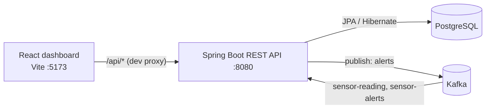
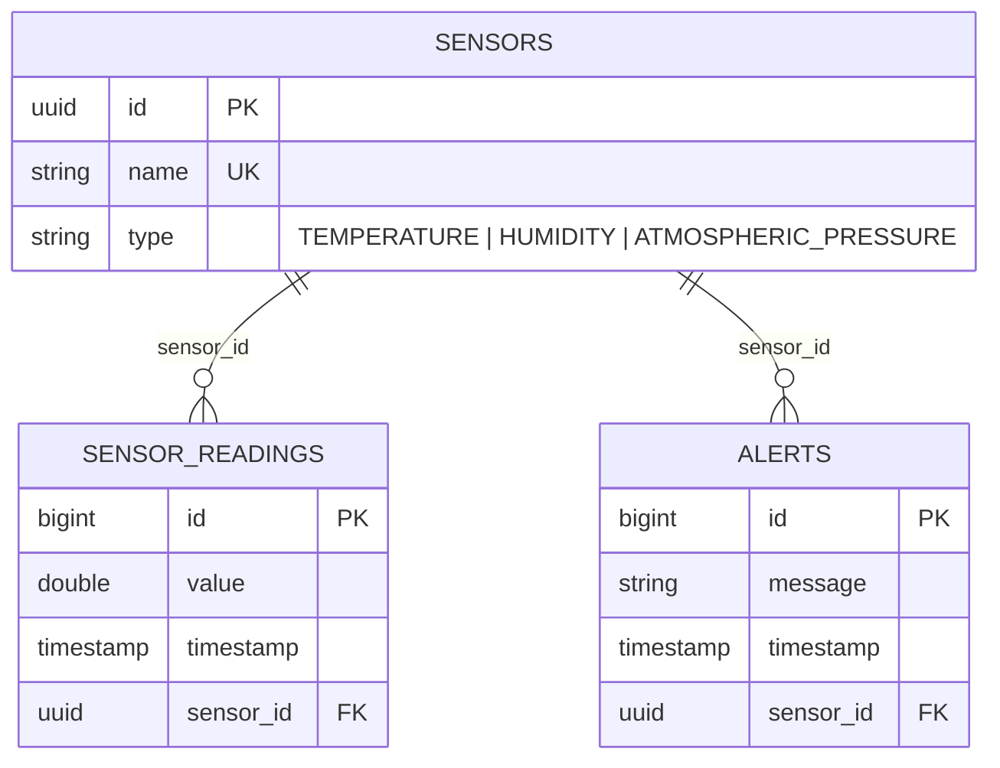
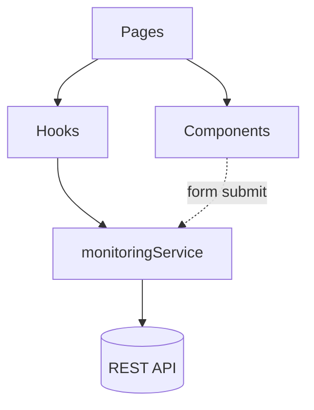
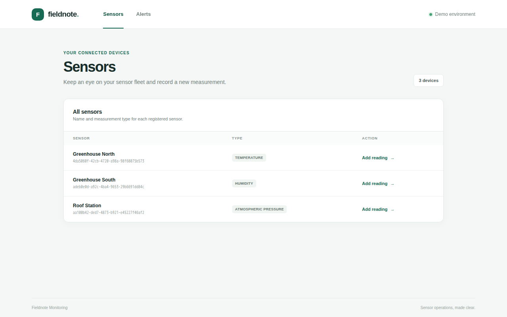
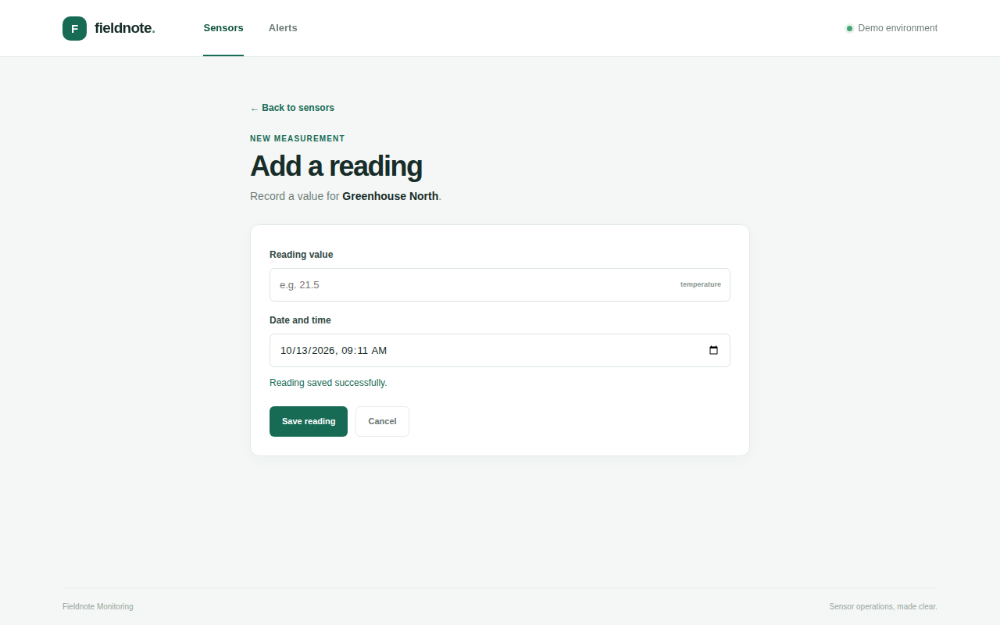
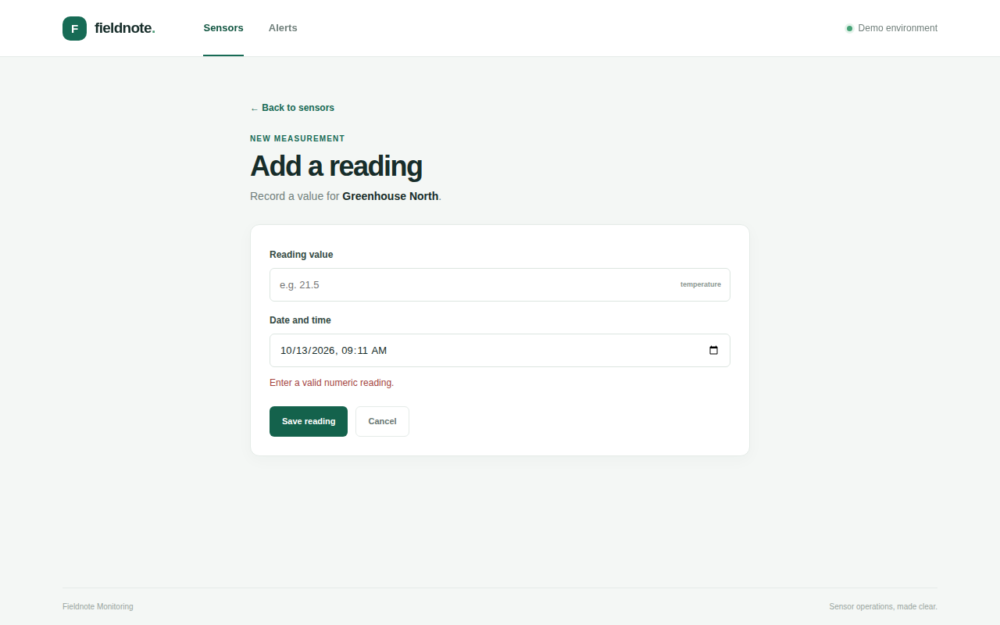
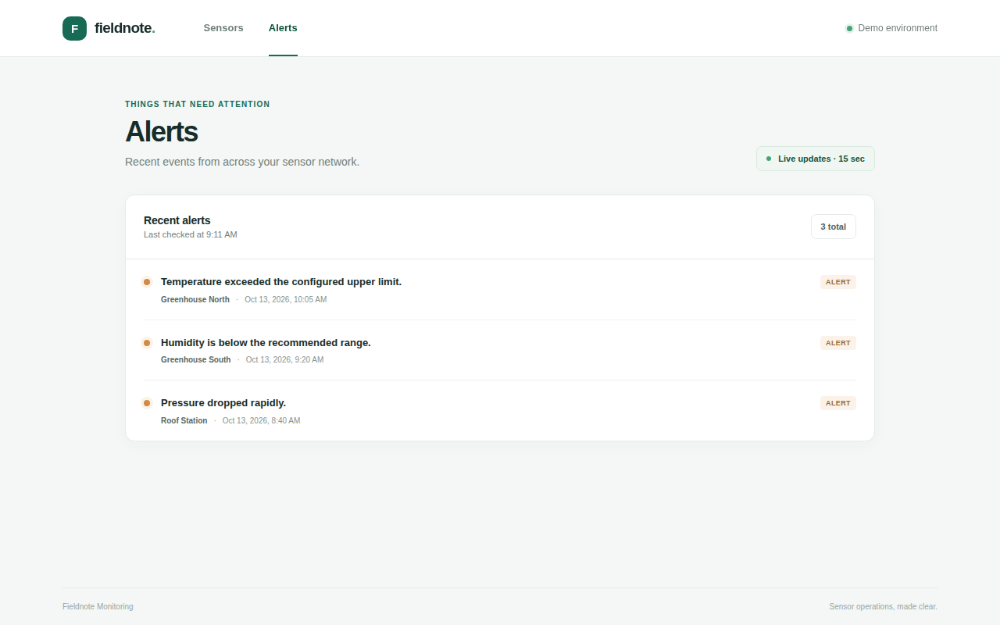
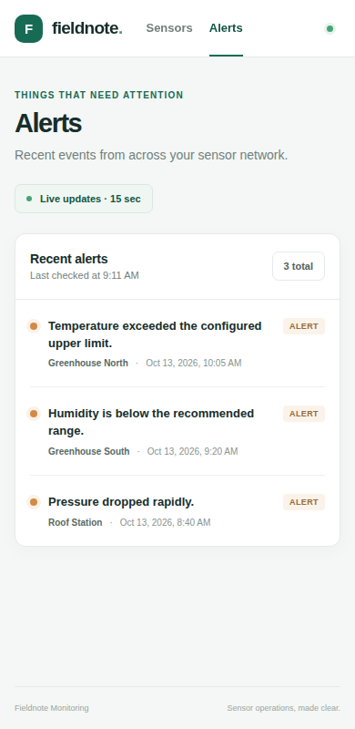

# IoT Sensor Monitoring – Project Documentation

This repository contains a small IoT monitoring system:

- `backend/` – Spring Boot 3.5 / Java 21 REST service backed by PostgreSQL, with Kafka messaging.
- `frontend/` – React 19 + TypeScript dashboard (Vite) that lists sensors, submits readings and shows alerts.

The task descriptions are in [backend/TASKS.md](backend/TASKS.md) and [frontend/TASK.md](frontend/TASK.md).



---

# Part 1 – Backend

## 1.1 Running it

| Need | Command |
| --- | --- |
| Infrastructure (PostgreSQL + Kafka) | `docker compose up -d` in `backend/` |
| Run the API | `./mvnw spring-boot:run` (JDK 21 required) |
| Run the tests | `./mvnw test` (Docker required, Testcontainers starts PostgreSQL 17.6) |

Connection settings are in [application.properties](backend/src/main/resources/application.properties): database `monitoring` on `localhost:5432` (user `monitoring_user`), Kafka on `localhost:9092`. Hibernate runs with `ddl-auto=create-drop`, so the schema is generated from the entities and the database starts empty on every run.

## 1.2 Package layout

```
com.aldisued.iot.monitoring
├── MonitoringApplication      Spring Boot entry point
├── config/KafkaConfig         JSON conversion for Kafka listeners
├── controller/                REST endpoints (thin)
├── dto/                       Request/response payloads (Java records)
├── entity/                    JPA entities and the SensorType enum
├── messaging/                 Kafka listeners
├── repository/                Spring Data JPA repositories
└── service/                   Business logic
```

The layering is controller → service → repository. Controllers only translate HTTP to service calls, and services own validation and rules, so the same service works for both HTTP and Kafka input (see 1.6).

## 1.3 Data model (entities)



| Class | Role and key decisions |
| --- | --- |
| `Sensor` | Table `sensors`. UUID id (generated), `name` is `unique` and not null. `type` uses `@Enumerated(EnumType.STRING)` (task 1) so stored values are readable and adding or reordering enum constants cannot silently corrupt existing rows, which is the risk with the default ordinal storage. Owns `alerts` and `sensorReadings` as inverse `@OneToMany(mappedBy = "sensor")` lists (task 2). Both lists are `@JsonIgnore` so `GET /sensors` returns only `id`, `name`, `type` and cannot recurse. `equals`/`hashCode` use getters and `instanceof` so they stay correct when Hibernate hands out lazy proxies. |
| `SensorReading` | Table `sensor_readings`. `@ManyToOne(fetch = LAZY, optional = false)` with `@JoinColumn(name = "sensor_id")`, as required by the task. `@JsonIgnore` on the sensor; the API exposes it through a DTO instead. |
| `Alert` | Table `alerts`, same relationship mapping as `SensorReading`. |
| `SensorType` | Enum: `ATMOSPHERIC_PRESSURE`, `TEMPERATURE`, `HUMIDITY`. |

**Decision – the many side owns the foreign key.** `SensorReading` and `Alert` are the owning sides. Their `setSensor` simply assigns the field. An earlier version also added the entity to `sensor.getSensorReadings()`. That forced Hibernate to load the sensor's whole reading collection on every insert, which is slow for high-frequency data and throws `LazyInitializationException` outside a transaction. Because the collections are inverse (`mappedBy`), they do not need to be kept in sync for persistence.

## 1.4 Repositories

| Repository | Notable methods |
| --- | --- |
| `SensorRepository` | `existsByName`, `findAllByOrderByNameAsc` |
| `SensorReadingRepository` | `findAverageValue(type, from, to)` (JPQL `avg`) and `findValues(type, from, to)` (ordered by timestamp, id) |
| `AlertRepository` | `findFirstBySensorIdOrderByTimestampDescIdDesc`, `findAllByOrderByTimestampDescIdDesc` |

**Decision – aggregate in the database.** The average and the value lists are computed by JPQL queries, not by loading all readings and streaming in Java. This scales with data volume and lets the database use indexes. `id` is a tie-breaker in the ordering so results are deterministic when timestamps are equal.

## 1.5 DTOs

Java records with Bean Validation annotations:

| DTO | Fields |
| --- | --- |
| `SensorDto` | `name` (`@NotBlank`), `type` (`@NotNull`) |
| `SensorReadingDto` | `sensorId`, `value`, `timestamp` (all `@NotNull`) |
| `AlertDto` | `sensorId`, `message` (`@NotBlank`), `timestamp`. Also the Kafka payload. |
| `SensorReadingResponseDto` | `id`, `sensorId`, `value`, `timestamp` |
| `AlertResponseDto` | `id`, `sensorId`, `message`, `timestamp` |

**Decision – response DTOs for readings and alerts.** The entities hide their `sensor` from JSON, so the frontend would not otherwise know which sensor a reading or alert belongs to. The response DTOs expose a flat `sensorId` and avoid serialising lazy proxies. Sensors are returned as entities because their JSON (`id`, `name`, `type`) already matches what the UI needs.

## 1.6 Services

| Class | Behaviour |
| --- | --- |
| `SensorService` | `saveSensor`: rejects a blank name or null type with **400**; trims the name; rejects an existing name with **409** (`SensorNameConflictException`). It checks `existsByName` first, and also catches `DataIntegrityViolationException` so two concurrent requests that both pass the check still get a 409 from the `unique` constraint instead of a 500. `findAllSensors` is sorted by name. |
| `SensorReadingService` | `saveSensorReading` (task 3): validates the DTO, loads the sensor (**404** if unknown) and saves the reading. Used by both the REST controller and the Kafka listener. |
| `AlertService` | `saveAlert` (task 6): validates, looks up the sensor (404 if unknown), saves the alert, then publishes the `AlertDto` to the Kafka topic `alerts` using `KafkaTemplate<String, AlertDto>`. `findLastAlertBySensorId` (task 5) returns the newest alert as an `AlertDto`, or **404** when there is none. `findAllAlerts` returns all alerts, newest first. |
| `MeasurementService` | `getAverageTemperature(from, to)` (task 7) returns `Optional<Double>` (empty when no readings match; the range is inclusive). `getMeasurementValuesBySensorType(type, from, to)` (task 8) returns values ordered by timestamp. Invalid arguments throw `IllegalArgumentException`. |
| `MeasurementCalculatorService` | Pure functions, no database. `filterByAverageDeviation(values, deviation)` (task 9) keeps values in `[avg − avg·d, avg + avg·d]`. The bounds are widened by one ulp (`Math.nextDown`/`nextUp`) so floating-point error does not drop values that are exactly on the boundary. Deviation outside `[0, 1]` (or NaN) throws `IllegalArgumentException`. `getMovingAverage(data, windowSize)` (task 10) uses a running sum, so it is O(n) and not O(n·window). A window ≤ 0 or larger than the data throws `IllegalArgumentException`. |
| `SensorNameConflictException` | `@ResponseStatus(CONFLICT)` runtime exception that Spring maps to HTTP 409. |

**Decision – ResponseStatusException for HTTP errors.** Services raise `ResponseStatusException` (or an annotated exception) with a message. `server.error.include-message=always` is set, so the error body carries a `message` that the frontend shows directly.

## 1.7 REST API

| Method and path | Description | Responses |
| --- | --- | --- |
| `GET /sensors` | All sensors, by name | 200 |
| `POST /sensors` | Body `{"name", "type"}` | 200, 400 (missing name or type), 409 (duplicate name) |
| `GET /sensor-readings` | All readings | 200 |
| `POST /sensor-readings` | Body `{"sensorId", "value", "timestamp"}` | 200, 400, 404 (unknown sensor) |
| `GET /alerts` | All alerts, newest first | 200 |
| `POST /alerts` | Body `{"sensorId", "message", "timestamp"}`; also publishes to Kafka | 200, 400, 404 |
| `GET /alerts/latest?sensorId=<uuid>` | Most recent alert for a sensor | 200, 400 (missing or malformed `sensorId`), 404 (no alert) |

Timestamps are ISO local date-times (`2026-10-13T10:05:00`, no zone), matching `LocalDateTime` in the model.

Controllers (`SensorController`, `SensorReadingController`, `AlertController`) hold no logic except mapping entities to response DTOs.

## 1.8 Kafka

| Class | Purpose |
| --- | --- |
| `AlertService` | Publishes saved alerts to topic `alerts` (task 6). |
| `SensorReadingListener` | `@KafkaListener` on topic `sensor-reading`. Calls `SensorReadingService.saveSensorReading`. |
| `AlertKafkaListener` | `@KafkaListener` on topic `sensor-alerts`. Calls `AlertService.saveAlert`. |
| `KafkaConfig` | Declares a `StringJsonMessageConverter`. |

**Decisions**

- Producer values use Spring Kafka's `JsonSerializer` (type headers off), so `AlertDto` is sent as plain JSON. The consumers keep a `StringDeserializer` and the converter turns the JSON string into whichever DTO the listener method declares. That lets two listeners with different payload types share one consumer configuration. A single `JsonDeserializer` with a fixed default type could not do that.
- Listeners and publisher are always active (not tied to a Spring profile), so the behaviour described in `TASKS.md` works in the default run configuration.
- Listeners reuse the same service methods as HTTP, so validation and persistence are identical for both input paths.

## 1.9 Tests

All of `backend/src/test` is driven by the task tests (`tasks/Task0Test` … `Task10Tests`).

- `IntegrationTestBase` starts the full application with the `docker` profile. `TestcontainersConfiguration` supplies a PostgreSQL 17.6 container via `@ServiceConnection`. Test data comes from `src/test/resources/sql/task-N-test-data.sql`.
- `Task9Tests`, `Task10Tests` and `MeasurementCalculatorServiceTests` are plain unit tests.
- Result at the time of writing: 38 tests, all passing.

## 1.10 Known limitations

- `GET /sensor-readings` and `GET /alerts` are unbounded. For real data volumes they need pagination or time-window parameters.
- Schema is created by Hibernate (`create-drop`) as the task requires. A real deployment would use migrations.
- The `alerts` topic (published) and `sensor-alerts` topic (consumed) have different names, as given by the original skeleton. The publisher is not looped back into the consumer.
- The Kafka listener path was not exercised end-to-end against a live broker in this review. The alert publish path was (saving an alert through `POST /alerts` succeeded and the producer connected). The listener parameter conversion is covered only by Spring's standard converter.

---

# Part 2 – Frontend

## 2.1 Running it

```sh
cd frontend
npm install
npm run dev        # http://localhost:5173  (note: there is no "npm start" script)
npm test           # Vitest
npm run build      # type-check + production build
```

Node 24+ is required (see `engines` and `.nvmrc`). Start the backend first. The database starts empty, so create a sensor, for example:

```sh
curl -X POST localhost:8080/sensors -H 'Content-Type: application/json' \
     -d '{"name":"Greenhouse North","type":"TEMPERATURE"}'
```

## 2.2 Architecture

The frontend separates four layers, as requested in task 4:

```
src/
├── services/monitoringService.ts   HTTP layer (fetch), error normalisation
├── hooks/useSensors.ts, useAlerts.ts   State layer (loading / error / data, polling)
├── components/                     Presentational components
└── pages/                          Route-level composition
```



| File | Responsibility and decisions |
| --- | --- |
| `types.ts` | `Sensor`, `SensorReading`, `NewSensorReading`, `Alert`, and the `SENSOR_TYPES` const. Types mirror the backend JSON (alert and reading ids are numbers, sensor ids are UUID strings). |
| `services/monitoringService.ts` | The only place that talks HTTP. Exposes `getSensors`, `getAlerts` (re-sorted newest first as a safety net) and `createReading`. A shared `request` helper turns network failures into "Unable to reach the monitoring service." and non-2xx responses into the backend's `message`, so the UI shows meaningful errors. The base URL is `/api` by default, configurable with `VITE_API_BASE_URL`. |
| `hooks/useSensors.ts` | Fetches sensors once, returns `{ sensors, isLoading, error }`. Ignores results that arrive after unmount. |
| `hooks/useAlerts.ts` | Fetches alerts immediately and then every 15 s (`POLL_INTERVAL_MS`). An in-flight guard prevents overlapping requests when the backend is slow, and the interval is cleared on unmount. A failed poll keeps the last good data in state and records the error. |
| `components/PageState.tsx` | One component for the loading, error and empty states, so all pages behave the same. Errors use `role="alert"` and the others `role="status"` for accessibility. |
| `components/SensorList.tsx` | Table of name, id and type, with an "Add reading" link to `/sensors/:id`. |
| `components/SensorReadingForm.tsx` | Controlled form for `value` and `timestamp` (`datetime-local`, defaults to now). Validates client-side (numeric value, valid date), disables the button while submitting, shows backend errors, and confirms success. |
| `components/AlertList.tsx` | Cards with message, resolved sensor name (falls back to "Unknown sensor") and formatted timestamp. |
| `pages/SensorsPage.tsx` | Task 1: sensor list with loading, error and empty states. |
| `pages/ReadingPage.tsx` | Task 2: route `/sensors/:id`. Redirects to `/sensors` if the id is unknown. |
| `pages/AlertsPage.tsx` | Task 3: alerts list using `useAlerts` for polling and `useSensors` to resolve names. |
| `App.tsx` / `main.tsx` | Routes: `/` → `/sensors`, `/sensors`, `/sensors/:id`, `/alerts`, anything else → `/sensors`. |
| `vite.config.ts` | Proxies `/api/*` to `http://localhost:8080/*` in development, so the browser sees one origin and the backend needs no CORS configuration. |

**Decisions**

- **Hooks instead of a state library.** The state is small (two lists plus one form), so custom hooks keep the state layer separate without adding Redux or a query library. If caching or retries are needed later, a data-fetching library can replace the hooks without touching components.
- **Polling, not WebSockets.** The task asks for "live-ish" updates and the backend has no push channel. A 15 s poll is simple and robust. The README describes SSE/WebSockets, pagination and downsampling for high-frequency data.
- **Service-level error mapping.** Components never see `fetch` details. They display `error.message`.

## 2.3 Screenshots

Captured from the running app (backend on PostgreSQL and Kafka, frontend on the Vite dev server).

**Sensors** (`/sensors`)



**Add a reading** – success after submitting (`/sensors/:id`)



**Add a reading** – client-side validation



**Alerts**, newest first, polled every 15 s (`/alerts`)



**Alerts on a narrow (mobile) viewport**



## 2.4 Tests

| File | Covers |
| --- | --- |
| `services/monitoringService.test.ts` | Newest-first alert ordering, POST body and URL for readings, backend error message surfaced, unreachable backend. `fetch` is stubbed. |
| `components/SensorList.test.tsx` | Names, types and the link to the reading form. |
| `components/SensorReadingForm.test.tsx` | Empty value is rejected without a request; a valid submission calls the service and shows success. |
| `pages/AlertsPage.test.tsx` | Fake timers: later polls update the list, polls do not overlap, and polling stops after unmount. |

Result: 4 files, 8 tests, all passing. `npm run build` also succeeds.

## 2.5 Known limitations

- The header badge reads "Demo environment" and is static text. It does not reflect the real connection state.
- There is no UI for creating sensors, since the task only requires listing sensors and adding readings. Sensors are created through `POST /sensors`.
- If an alert poll fails after an earlier success, the page replaces the list with the error until the next successful poll.
- Alerts and sensors are fetched in full. This is fine for the demo, but needs pagination for large data sets.
